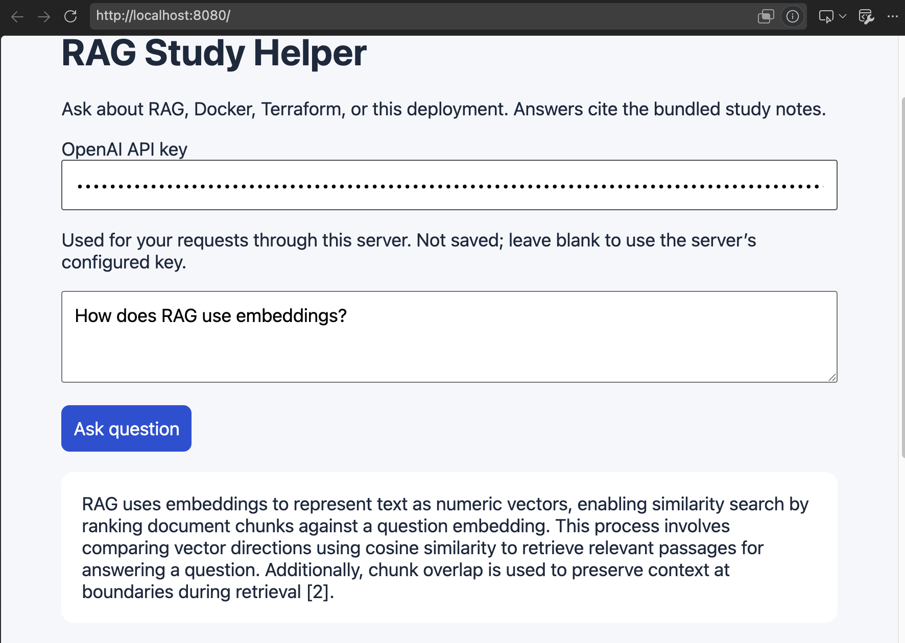
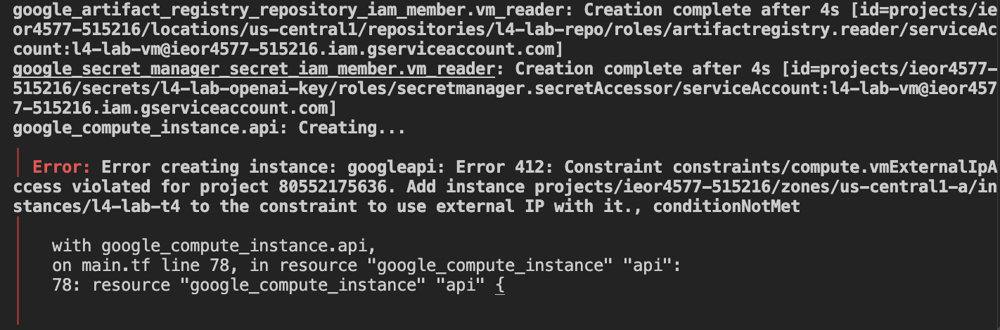

# Topics in AI

Coursework and a retrieval-augmented generation (RAG) application with Google Cloud deployment infrastructure.

See [Lab 4](lab4/README.md) for application setup and Terraform deployment instructions.

Local credentials, Terraform state, variable files, and generated caches are excluded from version control. Configure deployment values using `lab4/terraform/terraform.tfvars.example`.

# assignment3





```bash
cd lab4
docker build --platform linux/amd64 -t us-central1-docker.pkg.dev/YOUR_GCP_PROJECT_ID/l4-lab-repo/l4-lab-api:lab .
docker push us-central1-docker.pkg.dev/YOUR_GCP_PROJECT_ID/l4-lab-repo/l4-lab-api:lab
cd terraform
terraform init
terraform apply
```
